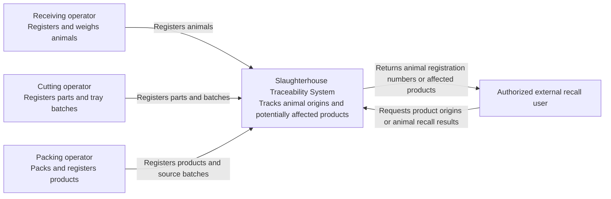
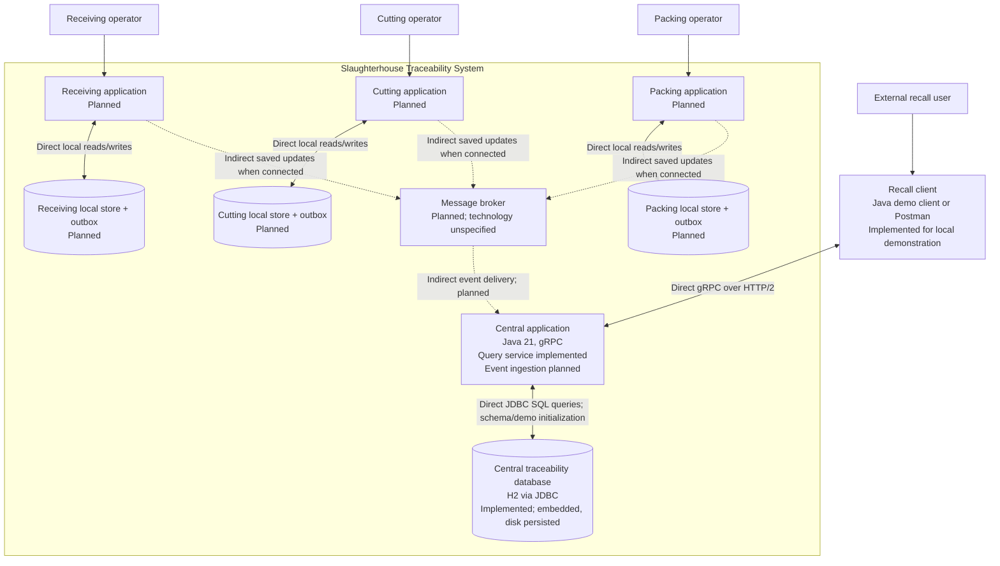
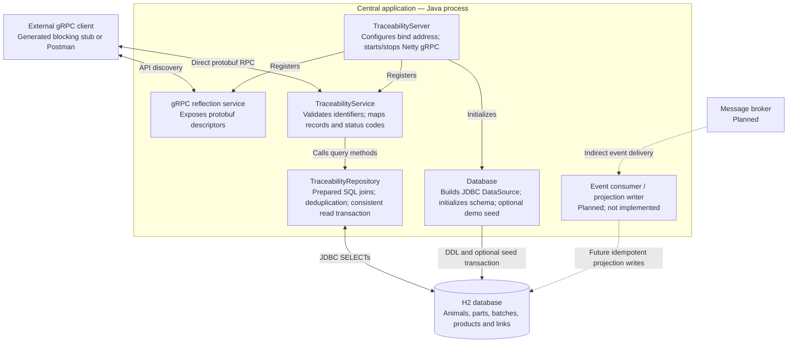

# Updated architecture — Part 2

These C4 views refine the supplied Part 1 architecture. Solid arrows labeled **direct** represent synchronous calls; arrows labeled **indirect** represent asynchronous messages. Boxes explicitly identify which components exist in Part 2. The station and broker design is retained so local work can continue through a network outage.

## C1 — System context

The external actor represents the intended system context. Part 2 demonstrates that interface with a local gRPC client; externally authenticated deployment remains future work.

## C2 — Container view

The embedded database is a logical data-store container, not a separately launched server. Stations save operational data and outgoing events locally before trying to synchronize. A future consumer projects the events into the central database. Queries do not call the stations or depend on the broker being online, but results may lag unsynchronized local activity. Part 2 uses explicit SQL demo initialization instead of implementing that event flow.

## C3 — Components of the central application

Generated protobuf code forms the transport boundary. The repository returns Java records, keeping SQL independent of protobuf. `TraceabilityService` maps those records into response messages and translates failures to gRPC status codes. `TraceabilityClient` lives outside the central application and exercises the same public contract as other clients.

## Decisions and limits

1. **Unary gRPC methods** match the two Part 2 lookups; one `.proto` defines messages and RPCs.
2. **H2 and JDBC** provide a real persistent database without additional infrastructure for assessment.
3. **Batch-level traceability** preserves the original model and conservatively includes every possible source animal. Reusing a tray creates a new batch identity.
4. **Deterministic, distinct results** eliminate duplicates caused by multiple parts or source batches.
5. **Offline stations remain a system requirement.** Local stores/outboxes and the broker are architecture only in this submission. Delivery deduplication, ordering, retries and synchronization visibility belong to a future ingestion implementation.
6. **Local demonstration boundary.** Plaintext, reflection and a loopback listener simplify testing. TLS and authorization must protect the external recall interface before deployment. They are not claimed as implemented.
7. **Scale.** Unary replies return all matches; pagination/streaming and connection pooling would be needed for much larger datasets. This implementation targets the coursework dataset.
