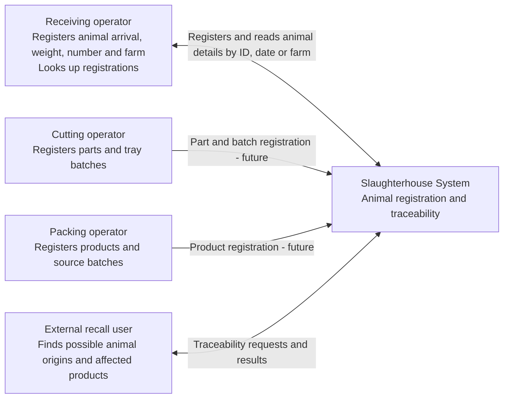
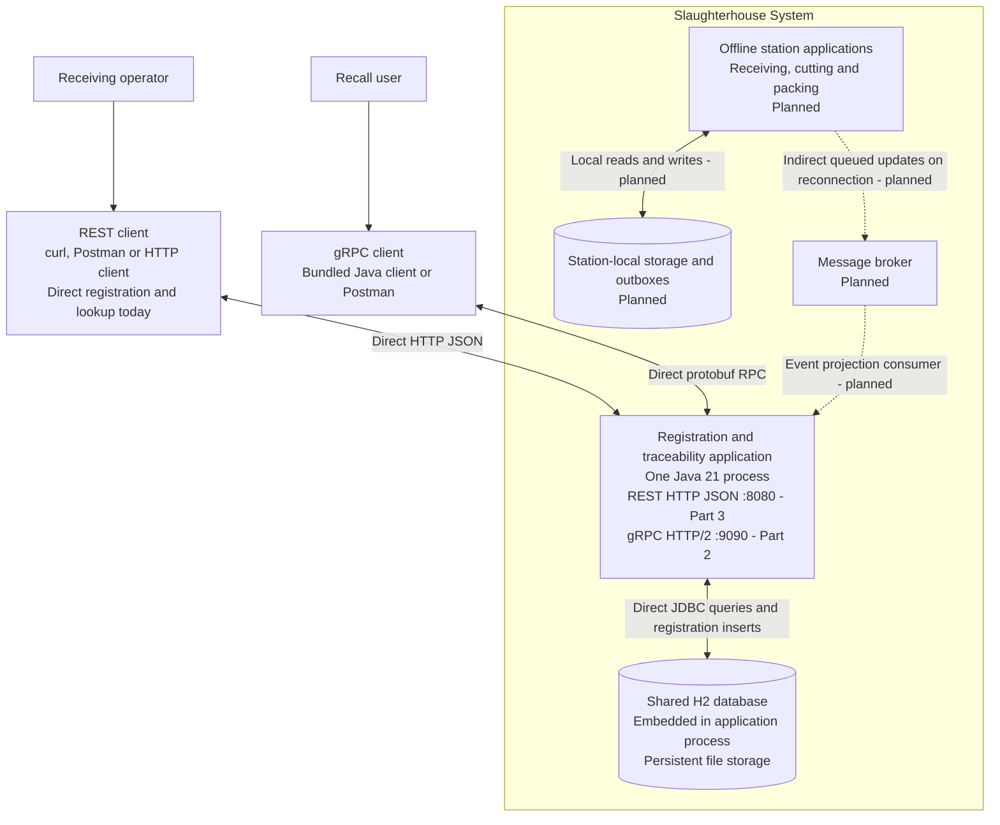
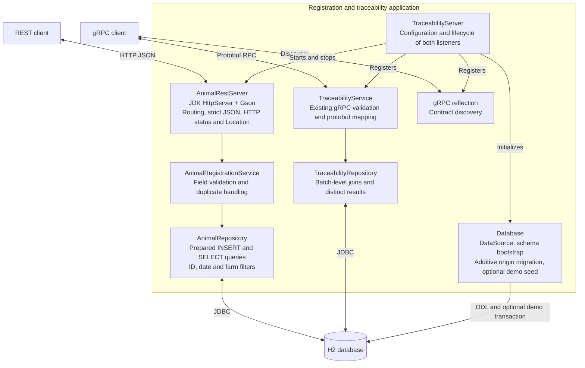

# Architecture — Parts 2 and 3

Part 3 adds animal registration and lookup over REST. The existing gRPC traceability interface remains available. Both interfaces run in one Java process and share a persistent H2 database. The [Part 2 views](architecture-part2.md) and [original Part 1 diagrams](part1/) are retained for comparison.

## C1 — System context

The receiving use cases now have a working REST API; no graphical UI is required. External authorization remains a deployment requirement, not a feature implemented in this coursework demo.

## C2 — Container view

**Deployment decision:** rather than opening the same embedded database file from two separate processes, both APIs share one application and `DataSource`. A REST registration is immediately visible to the gRPC service. H2 is drawn as a logical data store; it does not require a separate server. HTTP and gRPC handlers use separate threads and short-lived JDBC connections.

**Offline boundary:** the Part 1 station-local storage, outbox and broker architecture remains future work. This Part 3 REST implementation requires a reachable server to register an animal. It does not claim to satisfy the entire system's offline station workflow. Future ingestion must validate and deduplicate events and preserve tray-batch history; recall results remain limited to records already in the central database.

## C3 — Application components

`AnimalRegistration` is the REST data record. The REST adapter checks JSON syntax and types, decodes URLs, limits request bodies and maps application failures to JSON errors. The service validates registration rules; the repository owns SQL. Only the database enforces uniqueness, so simultaneous submissions cannot create duplicate animals. Every successful POST commits before returning `201 Created` with a `Location` header.

Existing gRPC protobuf fields and traceability joins are unchanged. Origin is exposed by REST; old gRPC clients remain compatible. A newly registered animal with no parts returns an empty successful gRPC product lookup rather than `NOT_FOUND`.

## Data changes and limits

- `migration-v2.sql` adds nullable `animal.origin` and lookup indexes, safely on repeated startup. Existing records retain `origin: null`; new REST registrations require an origin.
- The registration number is the animal identifier. Farm is an exact, case-sensitive string. Dates are calendar dates, without time zones; weights use decimal kilograms.
- Both filters may be combined with AND semantics; collection replies are sorted by registration number. Existing records with unknown origin appear in date/all-record queries, but not a named farm query.
- No graphical UI, update/delete endpoints, authentication, TLS, broker or offline queue is included. Default listeners are loopback-only. Production deployment needs authentication and TLS; larger datasets would need pagination and connection pooling.
- Tray-batch traceability remains conservative: all products using a batch may involve any animal contributing to that batch. Reusing the physical tray with a new batch does not connect historical batches.

Implementation references: [JDK HTTP server](https://docs.oracle.com/en/java/javase/21/docs/api/jdk.httpserver/com/sun/net/httpserver/HttpServer.html) and [Gson strict JSON configuration](https://javadoc.io/static/com.google.code.gson/gson/2.11.0/com.google.gson/com/google/gson/GsonBuilder.html).
