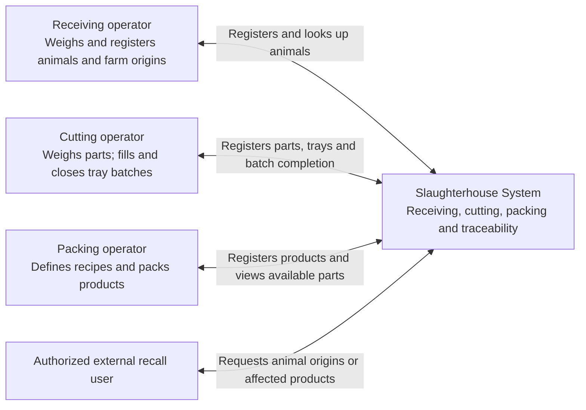
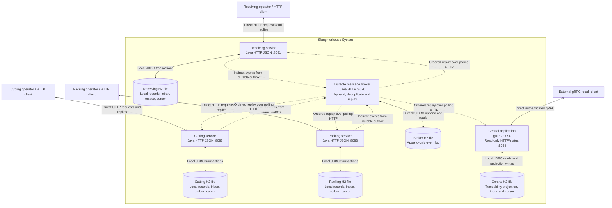
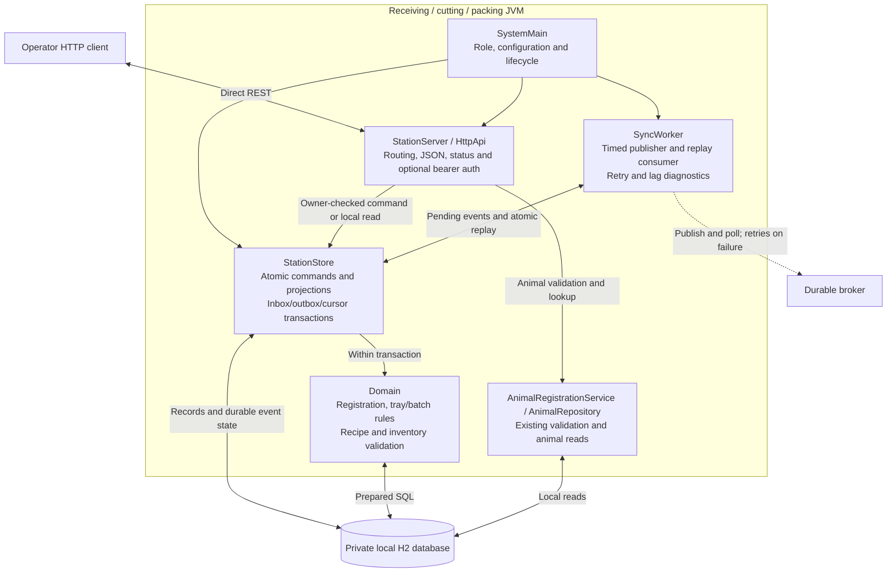
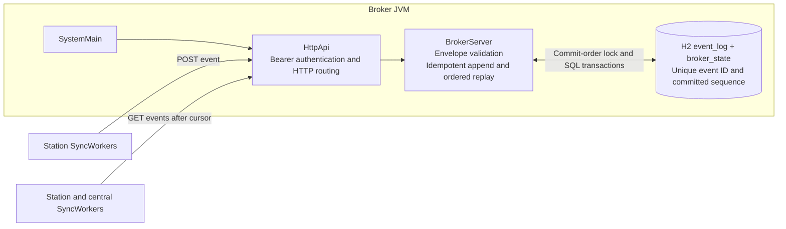
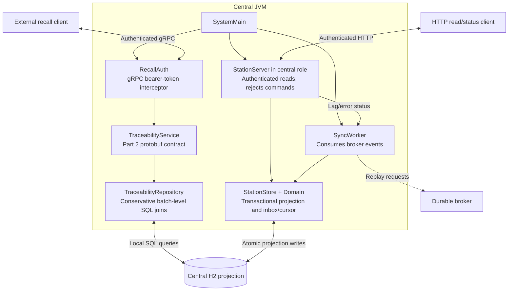

# C4 architecture — completed system, Part 4

The three station services now implement the full operational workflow. Each has its own persistent local database and outgoing queue. Indirect event delivery connects them through a durable broker; the central application serves external recall queries over gRPC. HTTP clients replace a GUI for assessment.

## C1 — System context

## C2 — Containers and communication

There are five independent JVM processes and five private database files. H2 stores are logical data containers embedded in their owning process, not separately networked database servers. No station command calls another station or central service. Each station keeps a full local projection of the event stream in this small system; only the owner of an operation can write new business events.

The custom broker provides durable fan-out over HTTP. Operator REST calls are direct; business updates are indirect because producers enqueue events without waiting for consumers. Broker acknowledgement confirms durable storage, not completion at every replica.

## C3 — Station components

The same station executable is configured with a receiving, cutting or packing role. The role determines allowed commands; its database persists the role to prevent accidental reuse.

| Station role | Domain commands | Key invariants |
| --- | --- | --- |
| Receiving | Register animal | Unique registration number; valid date, farm and positive decimal weight |
| Cutting | Create tray, open batch, register part, close batch | One part type; capacity; source animal; no late batch changes; tray empty before reuse |
| Packing | Define recipe, pack product | Exact required quantities/types; only closed batches; each part allocated at most once |

The local node-state row lock serializes commands and projection transactions. A successful command applies domain changes, records its inbox identity and adds its outgoing event in one commit. A rejected operation rolls everything back. Read endpoints return local data immediately, regardless of broker reachability.

## C3 — Broker components

The broker does not interpret inventory or call consumers synchronously. An identical retry returns the original sequence; a changed event with the same ID is rejected. The append lock prevents visible offset gaps caused by concurrent commits. The entire log is retained for replay.

## C3 — Central components

The original traceability contract is unchanged. Detailed product-part allocations now protect inventory, while recalls still join through source batches as in the Part 1 model. Reusing a tray never connects new batches to old products.

## Consistency and scope

Stations can operate offline with locally known dependencies, and persist outgoing changes until the broker returns. A newly arrived animal cannot be used at cutting before that registration reaches cutting; similarly packing must first receive a closed batch. There is no invented fallback data.

Synchronization status distinguishes queued writes, local replay position and the last observed broker position. It does not claim global recall completeness while any station may hold unpublished events. The implementation supports one writer process per role, multiple concurrent operator requests, and independent restarts. It includes bearer protection for internal broker access and external recall; default transport is local plaintext. Deployment/security and operational boundaries are documented in [operations.md](operations.md).

Earlier snapshots: [Part 2](architecture-part2.md), [Part 3](architecture-part3.md), and [original Part 1](part1/).
