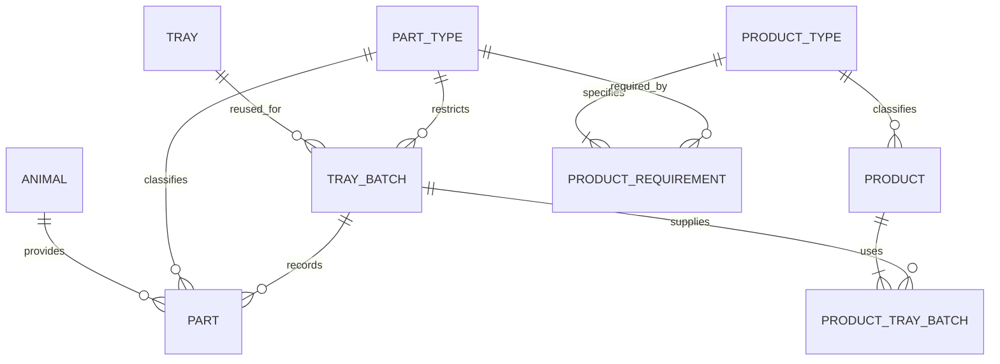

# Database design — Parts 2 and 3

H2 runs embedded in the central Java process and persists to disk by default. JDBC prepared statements execute every lookup against SQL tables. Each request uses a single repeatable-read transaction for its existence check and result query. Connections, statements and result sets are closed with try-with-resources.

## Mapping from Part 1

| Domain concept | SQL representation |
| --- | --- |
| Animal | `animal`; `animalId` mapped to `registration_number` |
| Part | `part`, including source animal and batch foreign keys |
| PartType | `part_type` |
| Tray | `tray`, including maximum weight |
| TrayBatch | `tray_batch`, with physical tray, part type and creation time |
| Product | `product` |
| ProductType | `product_type` |
| ProductRequirement | `product_requirement`, positive quantity per product/part type |
| Product takes parts from TrayBatch | `product_tray_batch`, many-to-many association |

The association table materializes the many-to-many relationship already present in the domain model; it is not a new physical station.

## Integrity

Primary/foreign keys prevent orphan traceability links. A composite foreign key `(batch_id, part_type)` ensures a part's type matches its batch. Positive checks protect weights, capacities and requirement quantities. The product–batch composite primary key prevents duplicate associations. Indexes support lookup by animal, batch and product.

The Part 2 traceability API is read-only. Part 3 adds validated animal INSERTs, but does not implement cutting/packing write operations. Aggregate tray capacity, recipe satisfaction, immutable closed-batch membership and the requirement that a finished product has at least one batch need validation in those future write transactions. The schema permits temporarily missing child rows so that a known entity without projected relationships can return an empty result. These states must not be treated as complete recall evidence.

## Query paths

For a product: filter `product_tray_batch.product_id`, join `part` by `batch_id`, and join `animal` by registration number. For an animal: filter `part.animal_registration_number`, join `product_tray_batch` by `batch_id`, then join `product`. Both queries use `DISTINCT` because an animal may contribute several parts and several batches to the same product; `ORDER BY` makes output deterministic.

A separate existence check distinguishes an unknown identifier from a known entity with no relationships. Bound JDBC parameters prevent identifier input from becoming SQL syntax.

## Synthetic example

| Batch | Physical tray | Part type | Animals | Products using batch |
| --- | --- | --- | --- | --- |
| B001 | T001 | leg | A001, A002 | P001, P002 |
| B002 | T002 | loin | A001 | P001 |
| B003 | T001 (later use) | leg | A003 | P003 |

A004 has arrived but has no registered parts yet. P001 has two source batches. Duplicate A001 parts in B001 and its contribution through B002 must still yield A001 only once.

## Initialization and persistence

`schema.sql` creates missing tables and indexes at startup; it is an idempotent version-1 schema bootstrap, not a migration system. `--demo` runs `demo.sql` in one transaction only when no animals exist. It does not overwrite existing records or repair a partially populated custom database. Without `--demo`, no sample data is inserted. Part 3 runs the additive `migration-v2.sql` after the bootstrap; future schema evolution should use a migration history tool.

Restarting the service from the same working directory reopens the same file. Generated database files are ignored by Git; the schema and synthetic seed script are version-controlled.

## Part 3 animal registration

The additive migration adds nullable `animal.origin VARCHAR(200)` plus indexes on `arrival_date` and `origin`. Null represents an unknown origin on an existing Part 2 record. The migration is idempotent and never drops or reseeds existing data. New REST registrations require a nonblank farm, even though the database column allows null for legacy compatibility.

`AnimalRepository` inserts the four required fields and optional species with prepared statements. `AnimalRegistrationService` checks date validity, text lengths and decimal weight bounds before insertion. The primary key prevents duplicate registration numbers, including racing requests; duplicate SQL state 23505 becomes HTTP 409. A single INSERT commits atomically before HTTP success.

Read queries use primary-key lookup or optional prepared equality predicates for date and origin, combined using AND and ordered by registration number. Origin matching is case-sensitive. Weights remain `DECIMAL(12,3)` and are JSON numbers in REST; the unchanged gRPC API retains decimal strings. Both APIs share the same database through one Java process.
