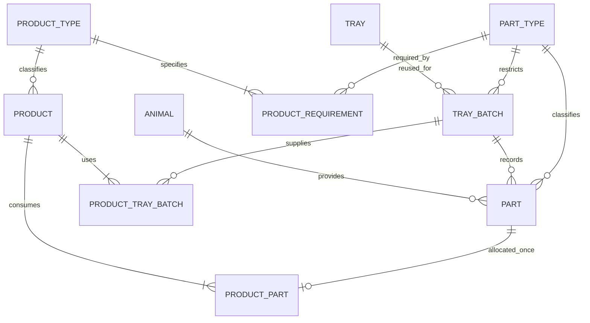

# Database and domain model — Part 4

The complete system uses five independent persistent H2 files. Stations and central use the existing domain schema plus additive origin and system extensions. The broker has a separate minimal log schema. Database initialization is repeatable; the launcher never resets data.

## Domain mapping

| Concept | Table / representation |
| --- | --- |
| Animal | `animal`, registration number, species, arrival date/weight and origin |
| Tray | `tray`, stable physical identifier and maximum weight |
| TrayBatch | `tray_batch`, one historical filling, tray, part type, creation time and closed flag |
| Part | `part`, weight, source animal, part type and historical batch |
| PartType | `part_type` |
| ProductType | `product_type` |
| ProductRequirement | `product_requirement`, required quantity per part type |
| Product | `product`, recipe/type and packing date |
| Product uses tray batch | `product_tray_batch` |
| Product consumes part | `product_part`, added for stock allocation; each part ID is unique |

`product_part` refines the original model with exact allocations needed to prevent double packing. The recall API intentionally retains conservative batch-level semantics: any animal contributing to a source batch may be involved in a product using that batch. Actual part IDs do not narrow the recall result. The original Part 1 images remain historical design artifacts.

## Enforced business rules

- Registration IDs are unique; date, origin, species and decimal weights are validated before INSERT.
- One open batch per tray. No new batch until all old parts in that tray have been packed and the cutting replica knows it.
- Every part references an existing local animal and batch. Its type must equal the batch's type. The composite database foreign key also enforces type equality.
- The sum of part weights in a batch cannot exceed tray capacity. Total registered part weight per animal cannot exceed arrival weight. Weights use DECIMAL(12,3).
- A nonempty batch can be closed once. Closing makes membership immutable. Packing only accepts closed batches.
- A recipe has distinct required types and positive integer quantities. Product selection must match the full recipe exactly and contain no duplicate part IDs.
- Product creation, part allocation, source-batch links and event enqueueing are atomic. The product_part primary key independently prevents double allocation.
- All parts and batch history remain after physical consumption. Available inventory is computed by the absence of an allocation; historical weight never decreases.

A single row in `node_state` is locked for each local write/replay transaction. This serializes concurrent operators and incoming projections, so aggregate weight checks and stock allocation cannot race. Only one station role owns each kind of domain mutation. The shared projection is not a multi-master inventory database.

## Durable messaging tables

| Node table | Purpose |
| --- | --- |
| `node_state` | Role identity, replay cursor and local write lock |
| `outbox` | Ordered outgoing JSON events, unique event IDs and delivery acknowledgement flag |
| `inbox` | Applied event IDs and content for idempotency and collision detection |

`Domain.apply`, the local inbox record and the outgoing outbox row commit together. Replay applies records, inserts an inbox record and advances the cursor together. Own events already in the inbox are skipped safely during replay. All four nodes consume the same ordered log; in this small application they retain full projections for independent local reads.

The broker uses `event_log(sequence_number, event_id, event_json)` and `broker_state(last_sequence)`. A transaction locks broker_state, checks the event ID, assigns the next sequence, inserts the event and advances the head. Offsets become visible in commit order. The broker keeps its complete log and does not delete acknowledged messages.

## Files and compatibility

- `schema.sql`: original domain tables and foreign keys.
- `migration-v2.sql`: nullable origin for legacy records and animal lookup indexes.
- `system.sql`: Part 4 closed-batch flag, product allocations and node event state.
- Broker tables are initialized by `BrokerServer` in its own database.
- `demo.sql`: legacy Parts 2/3 sample data only. The full-system demonstration uses real station APIs instead of injecting SQL fixtures.

Legacy Parts 2/3 databases remain readable by their original combined mode. A nonempty uninitialized legacy database is rejected as a Part 4 store because its earlier domain records have no outgoing event history or known inventory allocations. New role databases start with empty domain tables. Existing Part 4 stores retain role identity, data and synchronization position across restart.

## Traceability query paths

Product to animals: `product_tray_batch → part (by batch_id) → animal`. Animal to products: `part → product_tray_batch (by batch_id) → product`. Queries use prepared parameters, DISTINCT and deterministic ordering. A physical tray ID is never used to join a recall across different batches. Existence checks distinguish unknown entities from known entities with no matching products/animals.
